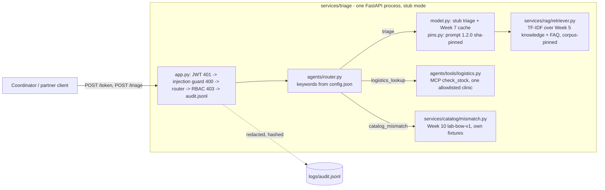

# Architecture

## Diagram

## Module boundaries
- **services/triage**: the API boundary. It owns auth (`auth.py`), validated JSON in and out (pydantic `Message`, `extra=forbid`, max 1000 characters), the Week 9 controls (`security/`, `redact.py`), the pinned prompt (`prompts/`, `pins.py`) and the stub model with its cache (`model.py`). `handle_message()` is the plain-function core, so tests call it without HTTP.
- **agents/**: `router.py` picks one tool from `config.json` keywords. `tools/logistics.py` is a real FastMCP server whose `check_stock` is called in-process (stub mode, no LLM agent loop) or over stdio (`python -m agents.tools.logistics`). Tool data is in `agents/tools/data/`.
- **services/rag**: a read-only, deterministic retriever plus a stub answerer that quotes one passage and cites source ids. It owns `knowledge/` and its `corpus_pin.json`.
- **services/catalog**: the Week 10 SokoniHub mismatch scorer. It shares the router and the auth door, nothing else.
- **evals/, tests/, scripts/**: the golden-set gate, the pytest pyramid (unit, integration, perf), fixture tools and perf measurement.
- **docs/**: this pack.

## Request order (defence in depth, Week 9)
1. JWT on every `/triage` call, or 401.
2. The injection guard returns 400 before any tool, retriever or model runs.
3. The router chooses a tool.
4. The RBAC matrix (`security/rbac.py`) returns 403 for an unknown role, or for a partner asking for triage.
5. The tool runs. `check_stock` re-checks the role and the clinic allowlist itself.
6. One audit row is written: actor, role, action, resource, outcome, trace id, and the payload redacted then hashed (triage text is hash-only).

## Data boundaries
| Data | Location | Why separate |
|---|---|---|
| Clinical intent fixture (300 synthetic rows: id, text, label) | `fixtures/triage_messages_sample.jsonl` | Health-adjacent text, which is special-category data under the Kenya DPA (Week 9) |
| SokoniHub marketplace listings (10) | `services/catalog/fixtures/sokonihub_catalog.json` | A retail client's data. It must never sit beside clinical rows |
| Clinic stock and allowlist | `agents/tools/data/` | Operational data, not personal data |
| Knowledge corpus | `services/rag/knowledge/` | Teaching guidance plus Week 5 captions, sha-pinned |

`tests/unit/test_fixture_separation.py` asserts no marketplace fields in the clinical fixture, no clinical fields in the catalog fixture, and no catalog file under `fixtures/`.
